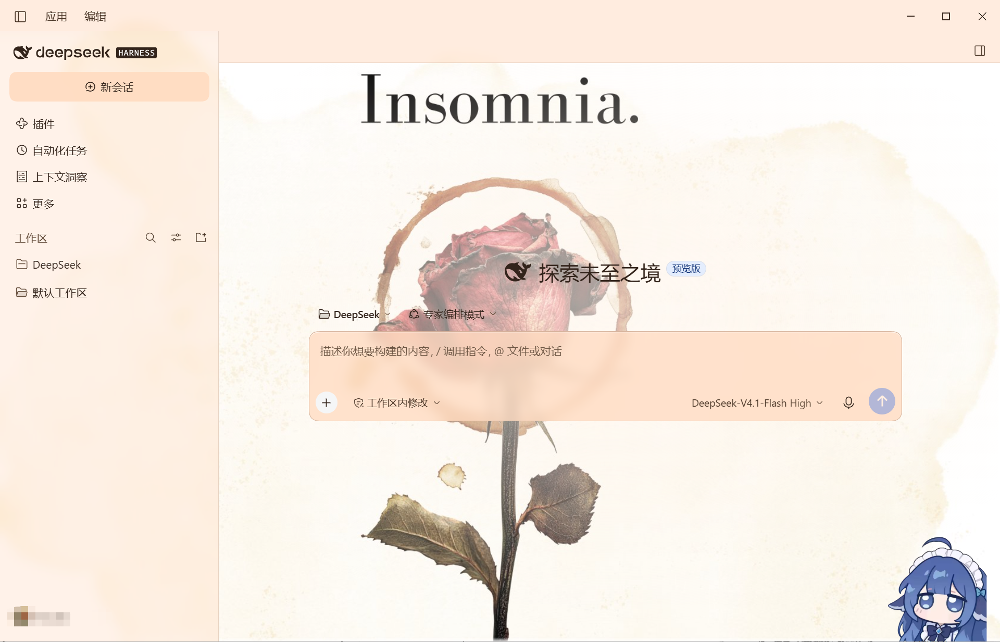
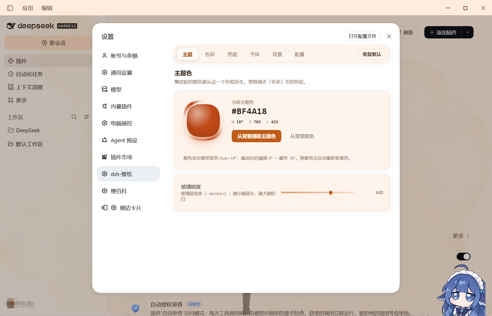
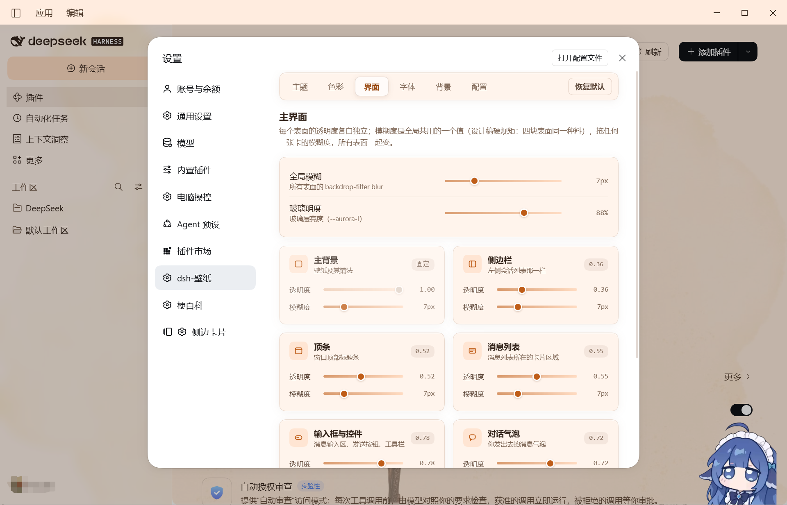
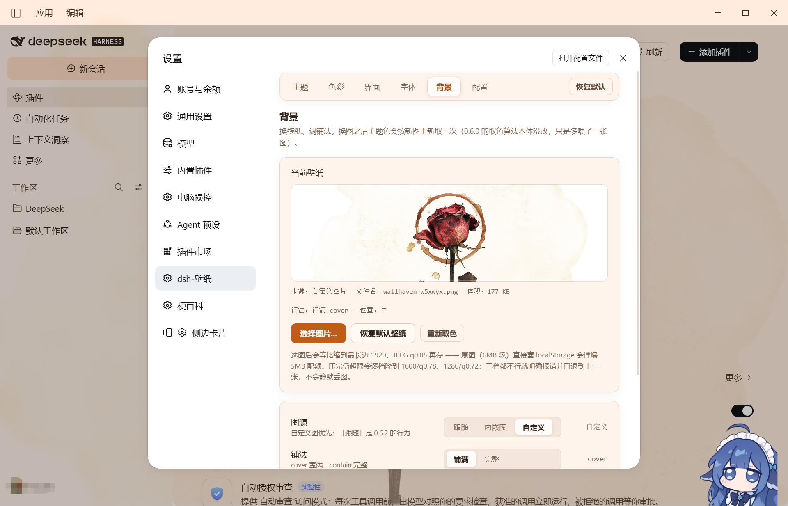
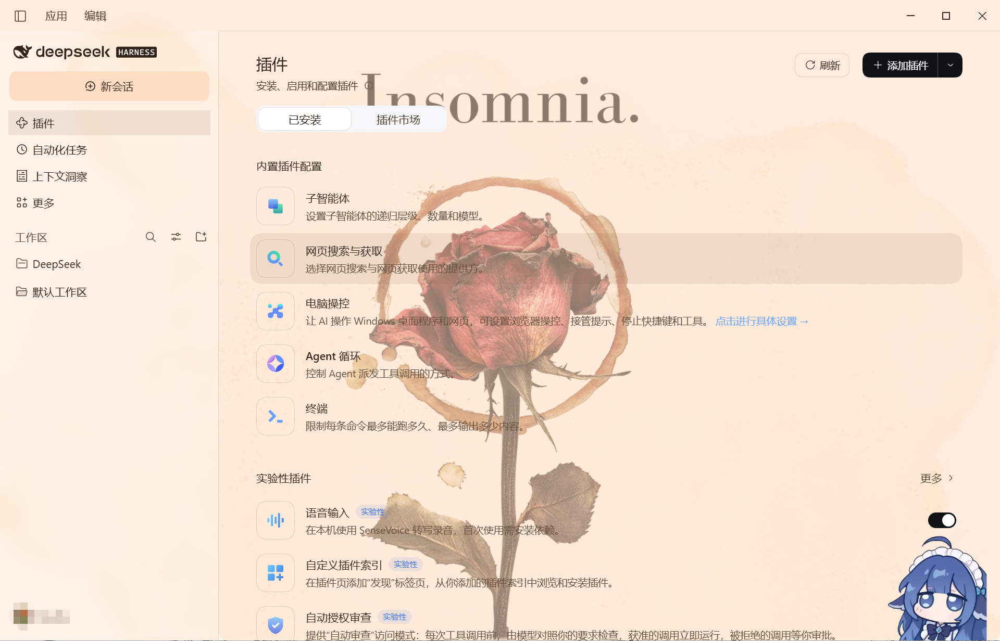

# dsh-desktop-skin

[简体中文](README.md) | [**English**](README.en.md)

A wallpaper-aware glass skin for DeepSeek Harness.

`dsh-desktop-skin` replaces the flat surfaces of the DSH desktop client with a semi-transparent
glass layer: the wallpaper shows through the top bar, sidebar, title bar, input area and message
cards, while the text keeps its contrast. The accent colour is **derived from the wallpaper
itself** — swap the wallpaper and the whole skin follows it. The look is a single injected
stylesheet; a small amount of JavaScript drives the settings panel, the wallpaper source and a
few scroll behaviours. No host service, no tool, no data collection.

## Screenshots



| Theme | Interface |
|---|---|
|  |  |

| Wallpaper | Plugins page |
|---|---|
|  |  |

## Features

### Wallpaper system

- **Bundled default wallpaper** — a line-art illustration, embedded in the plugin so the
  skin looks complete on a fresh install.
- **Custom wallpaper** — pick any image from disk. It is scaled down to a 1920 px long
  edge and re-encoded as JPEG (q 0.85) before being stored, because the whole settings
  object lives in `localStorage`. If the payload would still exceed the quota, it is
  re-compressed at 1600 px / q 0.78 and then 1280 px / q 0.72; if all three steps fail the
  previous wallpaper is restored and an explicit error is shown — never a silent data loss.
- **Fit and position** — `cover` or `contain`, plus a vertical anchor of top / centre /
  bottom.
- **Three wallpaper sources**, in priority order: `custom` (your own image) ›
  `follow` (mirror whatever the `dsh-any-background` plugin is currently showing) ›
  `default` (the bundled image). The skin does not require `dsh-any-background`, it can
  simply track it.
- **Theme colour extracted from the wallpaper** — the accent hue is sampled from the
  current image (histogram bucketing, low-saturation pixels skipped) and applied to every
  surface, so the skin shifts with the wallpaper. A manual override is available under
  the **Colour** tab.

### Layout

- The whole window frame is re-skinned: top bar, collapsible sidebar, title strip and
  input area share one surface treatment, with a wallpaper layer behind everything. Their
  height and width are left to the host — the skin changes surfaces, not geometry.
- **Message card** grows with its content up to a cap of `calc(100% - 8px - 33.334px)`,
  then scrolls internally instead of pushing the input box off screen. Corners are squared
  at the top and 14 px at the bottom.
- **Input area** keeps a 16 px radius and a 0.78 surface opacity, with the control row
  aligned to the same grid as the message card.
- Sidebar collapse state, new-session button and window controls are all re-aligned so
  nothing jumps when the sidebar folds away.

### Settings panel — six tabs

The skin registers its own page in **Settings → dsh-壁纸** (the in-app label is Chinese;
see *Known limitations*).

| Tab | What it controls |
|---|---|
| **Theme** | Current accent colour (HEX + HSL), “extract from wallpaper”, “pick from background”, glass lightness |
| **Colour** | Interactive hue wheel, HSL / RGB numeric inputs, inspiration palette |
| **Interface** | Global blur, glass lightness, and independent opacity for each surface |
| **Font** | Text font family (presets or custom stack), font scale, code font |
| **Background** | Wallpaper source, image picker, fit, vertical position, re-extract colour |
| **Config** | Export / import the whole settings object as JSON, reset to defaults |

Settings are persisted in `localStorage` under `dsh-aurora-skin:settings` and applied to
the live page immediately — no restart needed for visual changes.

### Interaction

- Auto-follow to the newest message when a reply arrives, instead of staying where you
  scrolled.
- A one-click “scroll to bottom” control, plus a bridge between the host's message rail
  and the skin's card cap.
- Hover, focus-visible and active states on rows, icon buttons, tabs and menu entries are
  re-drawn in the active accent palette, with a visible focus ring for keyboard use.
- The hue wheel is operable both by pointer and by keyboard, with ARIA roles on the tab
  list and panel.

### Visual details

- Scrollbars use a warm brown thumb (`rgba(120,74,46,.22)`, `0.48` on hover) instead of
  the host's default grey.
- Contrast is raised on the low-emphasis text that the host ships very light — measured
  examples: conversation tabs 2.61:1 → 6.46:1, filter chips 1.23:1 → 6.60:1, selected tab
  12.62:1.
- The plugin-market page, the settings page itself and the right-hand side panel get the
  same surface treatment, so switching pages does not break the illusion.

## Install

### From GitHub

```bash
dsh plugin add github:NiceCNJ/dsh-desktop-skin
```

Then restart DeepSeek Harness. Client-side plugins are **not** hot-reloaded — editing the
plugin or reinstalling it needs a reload of the renderer (restart the app, or press
`Ctrl+R` inside the window).

### Manual install

1. Clone this repository into your DSH plugins directory:

   ```bash
   git clone https://github.com/NiceCNJ/dsh-desktop-skin.git ~/.dsh/plugins/dsh-desktop-skin
   ```

2. Register it in the profile you use (`~/.dsh/profiles/<profile>/package.json`):

   - add `"dsh-desktop-skin": "file:../../plugins/dsh-desktop-skin"` to `dependencies`
   - add `"dsh-desktop-skin"` to `dsh.profile.bundles`

3. Make sure the plugin is **not** listed as disabled in `.dsh-market/state.json`, or the
   plugin market will re-apply the disabled state on next start.

4. Restart the app.

### Verify it loaded

Open DevTools (`Ctrl+Shift+I`) and check in the console:

```js
document.getElementById('dsh-aurora-skin-css')   // → <style>, the skin is injected
window.__DSH_AURORA_SKIN__.version               // → "0.10.2"
window.__DSH_AURORA_SKIN__.getSettings()         // → the live settings object
document.documentElement.dataset.dshAuroraSkin   // → "0.10.2"
```

The console also logs `[dsh-aurora-skin] v0.10.2 applied at …` on start-up.

> The `aurora` prefix in DOM attributes, style element ids, CSS variables and the
> `localStorage` key is kept on purpose: the package was renamed from `dsh-aurora-skin`,
> and keeping these ids preserves existing saved settings.

## Configuration

Everything is editable from the in-app panel (**Settings → dsh-壁纸**); the values map to
CSS custom properties on `<html>`:

| Control | CSS variable | Default |
|---|---|---|
| Global blur | `--aurora-blur` | 7 px |
| Sidebar opacity | `--aurora-sidebar-alpha` | 0.36 |
| Top bar opacity | `--aurora-topbar-alpha` | 0.52 |
| Input area / controls opacity | `--aurora-composer-alpha` | 0.78 |
| Card opacity | `--aurora-card-alpha` | 0.55 |
| Bubble opacity | `--aurora-bubble-alpha` | 0.72 |
| Code / highlight surfaces opacity | `--aurora-code-alpha` | 0.92 |
| Menus and popovers opacity | `--aurora-menu-alpha` | 0.96 |
| Glass lightness | `--aurora-l` | 88 % |
| Hue offset | `--aurora-hue` | derived from the wallpaper |

The exported config (Config tab) is a flat JSON object. The wallpaper bitmap itself is
**not** included — only a marker — because the base64 payload is several hundred kilobytes
to several megabytes. After importing a config on another machine, pick the wallpaper
again.

## Compatibility

- **DSH** `>= 0.2.0-rc.1` (declared in both `engines.dsh` and `dsh.compatibility.dsh`).
- **Windows** desktop client (the layout assumes the Windows title bar / window-control
  overlay).
- Node / browser versions are inherited from the host — the plugin ships as-is, no build
  step.

The skin targets the host's CSS-module class names (for example `mP3x-q_frame`,
`an3WzG_composerSeat`). These names are stable per module within a host build, but the
hash prefix can change when the host UI is recompiled, so a new DSH release may require
re-checking the selectors.

## Known limitations

- **Window corners stay square.** The outer window chassis is drawn by Electron; page CSS
  cannot round it. All inner surfaces do have rounded corners.
- **The window-control area is a native overlay.** Electron's `titleBarOverlay` (WCO) is
  painted by the OS compositor, so its background cannot be made translucent — it is
  matched to the skin's colour instead.
- **The “App / Edit” menu bar lives in a shadow root.** It is a custom element whose
  markup and `:host` style sit inside a `shadowRoot`, so a normal stylesheet cannot reach
  it; the plugin injects one small rule into that root at runtime. If a future host build
  switches to `attachShadow({ mode: 'closed' })`, that rule can no longer be applied and
  the 6 px corner on those menu items will return.
- **The settings panel UI text is Chinese.** The visual skin is language-neutral, but the
  panel labels are currently Chinese only.
- **Bundle size.** `lib/client.js` is ~1.4 MB because the default wallpaper is embedded as
  a base64 data URI (the plugin has no static-asset URL to serve it from).
- **Wallpaper storage is `localStorage`-bound.** A user-supplied wallpaper is downscaled
  and re-compressed to fit the quota; very large or already-quota-full profiles fall back
  to the bundled image with an error message.
- **Losing attachments when switching sessions is host behaviour.** The skin injects
  styles and a few scroll helpers; it does not touch session state, attachments or the
  message data flow.

## License

[MIT](LICENSE)
