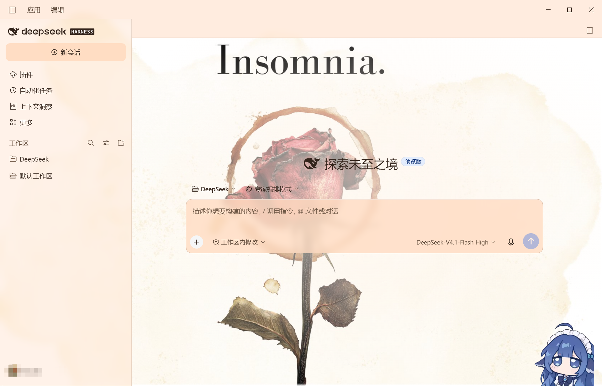
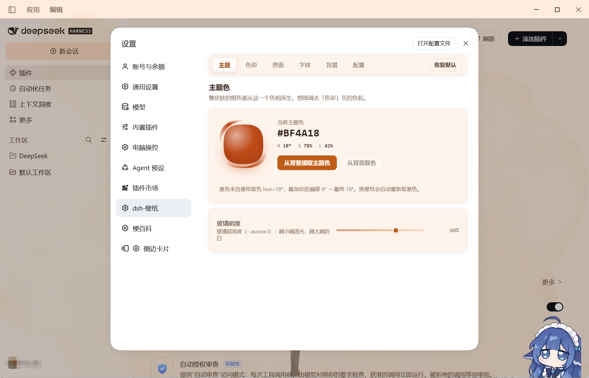
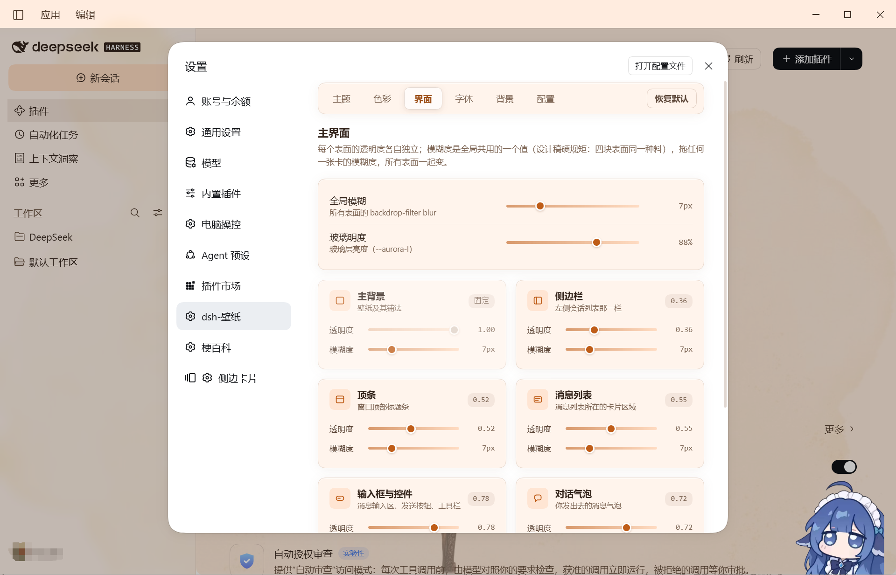
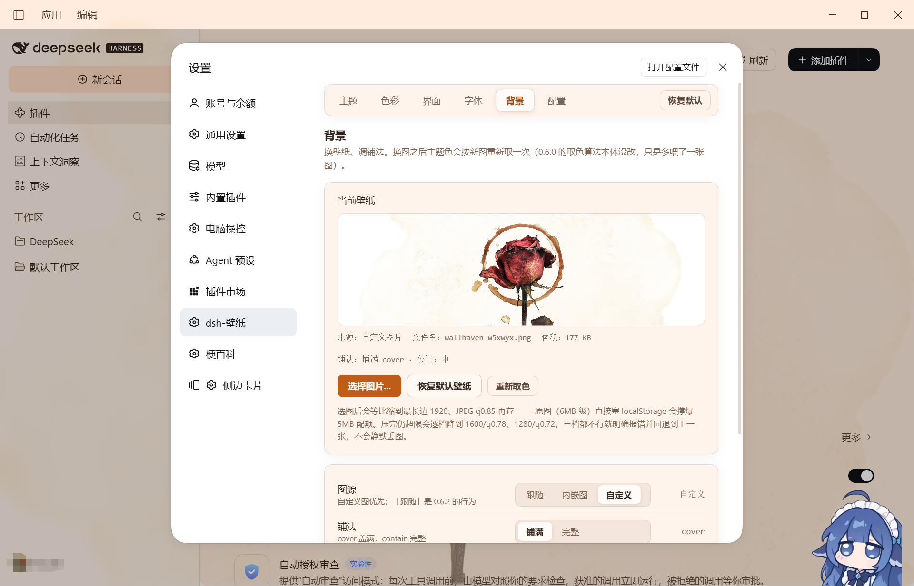
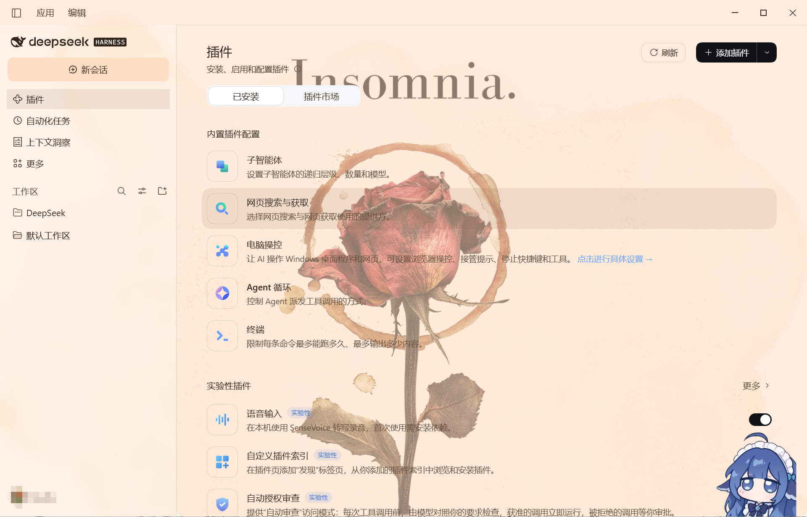

# dsh-desktop-skin

[**简体中文**](README.md) | [English](README.en.md)

DeepSeek Harness 的**壁纸感知玻璃皮肤**。

把 DSH 桌面端原本的实心表面换成一层半透明玻璃：壁纸从顶条、侧栏、标题条、输入区
和消息卡片后面均匀透出来，同时保住文字对比度。外观主体是一段注入的样式表，另有一小部分
JavaScript 负责设置面板、壁纸来源与几处滚动行为。不依赖宿主服务、不注册工具、不采集数据。



| 主题 | 界面 |
|---|---|
|  |  |

| 背景 | 插件页 |
|---|---|
|  |  |

## 功能

### 壁纸系统

- **内嵌默认壁纸**：一张线稿插图，随插件打包，装上即有完整观感。
- **自定义壁纸**：可从磁盘选图。选中的图会先等比缩到最长边 1920 px、按 JPEG q0.85 重新
  编码再存入 —— 整份设置存在 `localStorage` 里，原图直接存会撑爆配额。仍然超限时逐档降为
  1600 px / q0.78、1280 px / q0.72；三档都不行就明确报错并把壁纸字段回滚到上一张，
  不静默丢图、不把已有设置写坏。
- **铺法与位置**：`cover` / `contain` 两种铺法，纵向锚点可选上 / 中 / 下。
- **三种图源**，优先级从高到低：`custom`（自己的图）› `follow`（跟随 `dsh-any-background`
  当前那张图）› `default`（内嵌图）。本皮肤**不依赖** `dsh-any-background`，只是可以跟着它走。
- **从壁纸取主题色**：色相从当前壁纸采样得出（分桶统计，低饱和像素跳过），整界面的强调色
  跟着壁纸走。想锁死色相可以在「色彩」tab 手动指定。

### 布局

- 整套窗口框架重做：顶条、可收起侧栏、标题条、输入区共用同一种表面处理，壁纸层垫在最底下。
  顶条高度与侧栏宽度沿用宿主的值 —— 皮肤只改「表面」，不改几何尺寸。
- **消息卡片**按内容撑高，封顶 `calc(100% - 8px - 33.334px)`（减数 = 卡片自身 padding 32 px
  + 边框 1.334 px + 上下留白 8 px），到顶后在卡片内部滚动，不把输入框顶出视口。
  四角为上两角直角、下两角 14 px。
- **输入区**保持 16 px 圆角与 0.78 的底色透明度，控件行与消息卡片对齐同一栅格。
- 侧栏收起态、新会话按钮、窗口三键区都重新对位，侧栏折叠时不会跳位。

### 设置面板（六个 tab）

皮肤在宿主 **设置 → dsh-壁纸** 里注册了自己的页面：

| Tab | 能调什么 |
|---|---|
| **主题** | 当前主题色（HEX + HSL）、「从背景提取主题色」、「从背景取色」、玻璃明度 |
| **色彩** | 可交互色轮、HSL / RGB 数值输入、灵感色板 |
| **界面** | 全局模糊、玻璃明度，以及每块表面的独立透明度 |
| **字体** | 正文字体族（预设或自定义字体栈）、字号缩放、代码字体 |
| **背景** | 图源、选图、铺法、纵向位置、重新取色 |
| **配置** | 整份设置导出 / 导入为 JSON、恢复默认 |

设置存在 `localStorage` 的 `dsh-aurora-skin:settings` 键下，写入即时生效，视觉调整不需要重启。

### 交互增强

- 新回复到达时自动跟随到最新一条，而不是停在用户翻到的位置。
- 一键滚到底控件，并把宿主消息刻度与本皮肤卡片的封顶高度桥接起来。
- 行、图标按钮、标签页、菜单项的 hover / focus-visible / active 态全部跟随主题色系，
  键盘操作时有可见的焦点环。
- 色轮同时支持指针与键盘操作，tab 列表与面板带完整 ARIA 角色。

### 视觉细节

- 滚动条滑块改成暖棕 `rgba(120,74,46,.22)`（hover 时 `.48`），替换宿主默认色。
- 宿主原本过淡的次要文字整体提亮，实测对比度举例：对话标签页 2.61:1 → 6.46:1、
  筛选标签 1.23:1 → 6.60:1、选中态 12.62:1。
- 插件市场页、设置页本身、右侧栏面板都套用同一套表面处理，切换页面不会「出戏」。

## 安装

### 从 GitHub 安装

```bash
dsh plugin add github:NiceCNJ/dsh-desktop-skin
```

装完**重启 DeepSeek Harness**。客户端插件不走热重载 —— 改插件或重装后必须重载渲染进程
（重启应用，或在窗口内按 `Ctrl+R`）。

### 手动安装

1. 克隆到 DSH 插件目录：

   ```bash
   git clone https://github.com/NiceCNJ/dsh-desktop-skin.git ~/.dsh/plugins/dsh-desktop-skin
   ```

2. 在使用中的 profile（`~/.dsh/profiles/<profile>/package.json`）里登记：

   - `dependencies` 加 `"dsh-desktop-skin": "file:../../plugins/dsh-desktop-skin"`
   - `dsh.profile.bundles` 加 `"dsh-desktop-skin"`

3. 确认 `.dsh-market/state.json` 里**没有**把它标成禁用，否则插件市场会在下次启动时
   重放禁用状态。

4. 重启应用。

### 验证是否加载成功

打开 DevTools（`Ctrl+Shift+I`），在 Console 里：

```js
document.getElementById('dsh-aurora-skin-css')   // → <style>，说明样式已注入
window.__DSH_AURORA_SKIN__.version               // → "0.10.2"
window.__DSH_AURORA_SKIN__.getSettings()         // → 当前整份设置
document.documentElement.dataset.dshAuroraSkin   // → "0.10.2"
```

启动时 Console 还会打印一条 `[dsh-aurora-skin] v0.10.2 applied at …`。

> DOM 属性、样式元素 id、CSS 变量和 `localStorage` 键里保留 `aurora` 前缀是刻意的：
> 包已从 `dsh-aurora-skin` 改名而来，保留这些 id 可以让老用户已有的设置继续生效。

## 配置项

全部在宿主 **设置 → dsh-壁纸** 里调，落成 `<html>` 上的 CSS 自定义属性：

| 控件 | CSS 变量 | 默认值 |
|---|---|---|
| 全局模糊 | `--aurora-blur` | 7 px |
| 侧边栏透明度 | `--aurora-sidebar-alpha` | 0.36 |
| 顶条透明度 | `--aurora-topbar-alpha` | 0.52 |
| 输入框与控件透明度 | `--aurora-composer-alpha` | 0.78 |
| 对话框中选项面板透明度 | `--aurora-card-alpha` | 0.55 |
| 对话气泡透明度 | `--aurora-bubble-alpha` | 0.72 |
| 产出物与高亮内容透明度 | `--aurora-code-alpha` | 0.92 |
| 菜单与浮层透明度 | `--aurora-menu-alpha` | 0.96 |
| 玻璃明度 | `--aurora-l` | 88 % |
| 色相 | `--aurora-hue` | 由壁纸取色得出 |

「配置」tab 导出的是一份扁平 JSON。**壁纸图本体不进 JSON**（base64 几百 KB 到几 MB），
只带一个「是否自定义」标记；换机器导入后需要在「背景」tab 重新选一次图。

## 兼容性

- **DSH** `>= 0.2.0-rc.1`（同时在 `engines.dsh` 与 `dsh.compatibility.dsh` 里声明）
- **Windows** 桌面端（布局按 Windows 标题条 / 窗口三键浮层设计）
- 无构建步骤，随宿主运行时直接加载

### 已验证版本

| 插件版本 | 已验证 DSH 版本 | 验证日期 | 备注 |
|---|---|---|---|
| 0.10.8 | `0.2.1-rc.3` | 2026-11-22 | 旧构建，前缀 `mP3x-q` 系列 |
| 0.10.8 | `0.2.2-rc.5`（NEXT 2.0.24-next） | 2026-11-22 | 新构建，前缀已变 `vcssFG` 系列 |

### 类名自适应（0.10.7 起）

宿主的 CSS Modules 类名格式是 `<哈希前缀>_<局部名>`（例如 `mP3x-q_frame`），
那个哈希前缀是**内容哈希**，宿主每次重新编译都可能变。

**0.10.7 之前**插件把前缀写死在代码里，宿主一重编译整套样式就失效。
**0.10.7 起**改成运行时解析：

1. 启动时扫描 `document.styleSheets` 与 DOM，用一组固定探针类名反查当前前缀
2. 扫不到就退到内置的 FALLBACK 表
3. 把 CSS 模板里的占位符替换成真实前缀再注入，扫到新前缀时自动重刷

所以**宿主小版本升级通常不需要更新插件**。装好后可以自查：

```js
window.__DSH_AURORA_SKIN__.diagnostics()
// { resolved: '15/15', missing: [], prefix: { 'mP3x-q': 'vcssFG', ... } }
```

`resolved` 不满时 console 会有一条 `warn` 指出缺哪几组——把那行发出来就能定位。


## 已知限制

- **窗口外框四角是直角。** 外层窗口由 Electron 绘制，网页 CSS 够不到；内部所有表面都是圆角。
- **窗口三键区是系统浮层。** Electron 的 `titleBarOverlay`（WCO）由系统合成器绘制，
  做不到半透明，皮肤只能把它对齐到同一色系。
- **「应用 / 编辑」菜单在 shadow root 里。** 它是一只自定义元素的 shadow DOM，普通样式表
  进不去；插件在运行时往那个 root 注入一条小规则来抹掉 6 px 圆角。若宿主改用
  `attachShadow({ mode: 'closed' })`，这条规则就注入不了，那处圆角会回来。
- **插件体积约 1.4 MB。** 默认壁纸以 base64 内嵌进 `lib/client.js` —— 插件没有可用的静态
  资源 URL，只能内嵌。
- **壁纸受 `localStorage` 配额约束。** 自定义壁纸会被压缩到配额内；配额已满的 profile 会
  回退到内嵌图并给出提示。
- **切换会话丢附件属于宿主行为。** 本皮肤只注入样式和几处滚动逻辑，不碰会话状态、
  附件与消息数据流。

## 目录结构

| 文件 | 作用 |
|---|---|
| `package.json` | 包声明：`dsh.compatibility.dsh` 范围、`dsh.bundle.patch` 登记层、`dsh.client`（platform=web, immediately=true） |
| `cordis.patch.yml` | 插件登记层，装进 profile 时被合并进组合配置 |
| `lib/index.js` | host 侧占位（ESM）：无 host 逻辑，只为让插件行能正常加载 |
| `lib/client.js` | **主体**：`window.__ModuleLoader__.load()` + CommonJS 工厂 + 注入 `<style>`；壁纸以 data URI 内嵌 |
| `assets/wallpaper.jpg` | 默认壁纸原件（与 `lib/client.js` 内嵌的那份同源） |
| `tools/sync-wallpaper.mjs` | 换图后重新把 `assets/wallpaper.jpg` 写进 `lib/client.js` 的维护脚本，支持 `--dry-run` |
| `example_img/` | 文档截图 |

## 实现要点（踩过的坑）

1. **客户端加载器不支持 ESM。** 必须用 `window.__ModuleLoader__.load({ id, factory })`
   加 `module.exports` 那套；写成 `export default` 会报 `Unexpected token 'export'`。
   `lib/index.js` 反而是 ESM —— host 侧走 Node ESM，两边契约不同。
2. **CSS Modules 类名带 hash 前缀。** 形如 `mP3x-q_frame`、`an3WzG_composerSeat`。
   前缀每个 module 一个，随宿主重新编译可能变，升级宿主后要重新核对。
3. **属性选择器挂在 `<html>` 上。** `data-windows-titlebar`、`data-ds-dark-theme`、
   `data-platform` 都在 `documentElement`，所以皮肤根选择器写成 `html[data-dsh-aurora-skin] …`。
4. **CSS 是 JS 模板字符串。** 模板里任何位置出现反引号都会提前闭合字符串，导致整份
   client.js 语法错误、插件静默加载失败，而屏幕上还挂着上次注入的样式，看起来一切正常。
   CSS 内部一律不用反引号，改完必须 `node --check`。
5. **改完不重启不生效。** 客户端插件不热重载，实测等待 5~10 秒界面毫无变化，
   按 `Ctrl+R` 重载渲染进程或重启应用才生效。

选择器不是猜的：全部从宿主打包产物里的真实类名读出（`dsh-client-ui-layout`、
`dsh-client-ui-conversation`、`dsh-client-ui-chat`、`dsh-client-ui-sidebar`、
`dsh-client-ui-theme` 各自的 `lib/client.js` 与前端 CSS 产物）。

## 卸载

1. 从 profile 的 `dependencies` 与 `dsh.profile.bundles` 里删掉 `dsh-desktop-skin`。
2. 需要的话清掉 `localStorage` 里的 `dsh-aurora-skin:settings`。
3. 重启应用。

## 许可

[MIT](LICENSE)

## 反馈与联系

遇到问题、想提建议，或者只是想聊聊：

- **GitHub Issues**：[提交问题](https://github.com/Nicecn/dsh-desktop-skin/issues)（推荐，方便追踪）
- **QQ**：`1643381776`

报问题时如果方便，请附上这些信息，定位会快很多：

1. DSH 版本（设置 → 关于，能看到版本号）
2. 插件版本（设置 → dsh-壁纸 → 配置，或看 `client.js` 里的 `VERSION`）
3. 控制台里 `window.__DSH_AURORA_SKIN__.diagnostics()` 的输出
4. 控制台有没有红色的 `[dsh-aurora-skin]` 报错行
5. 一张截图（界面问题最有说服力）

